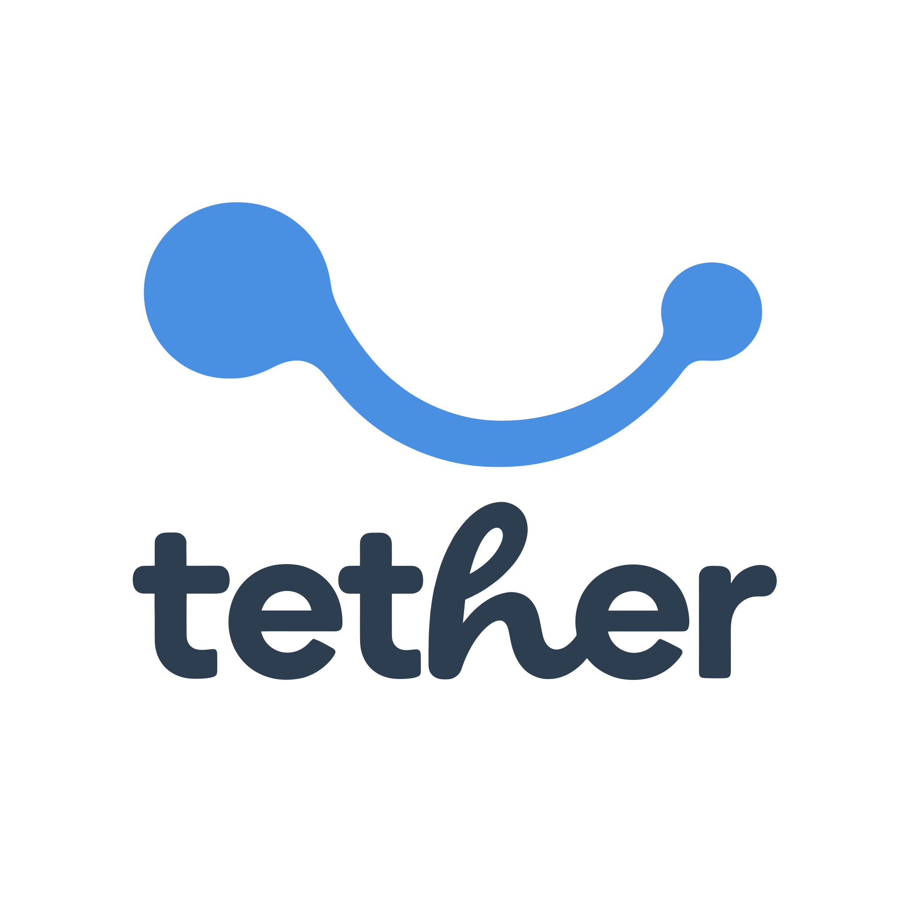
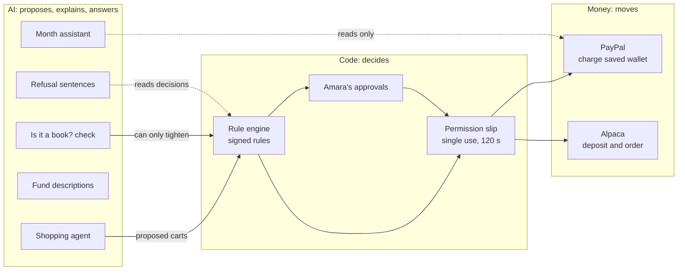
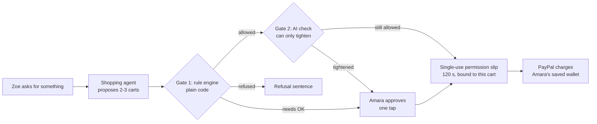
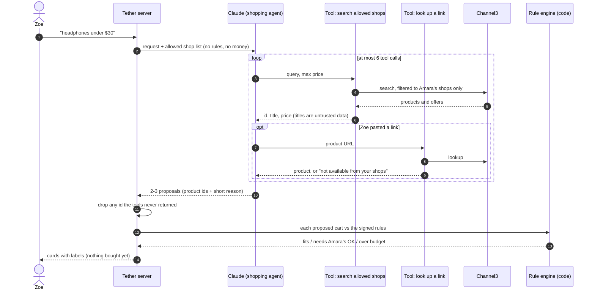
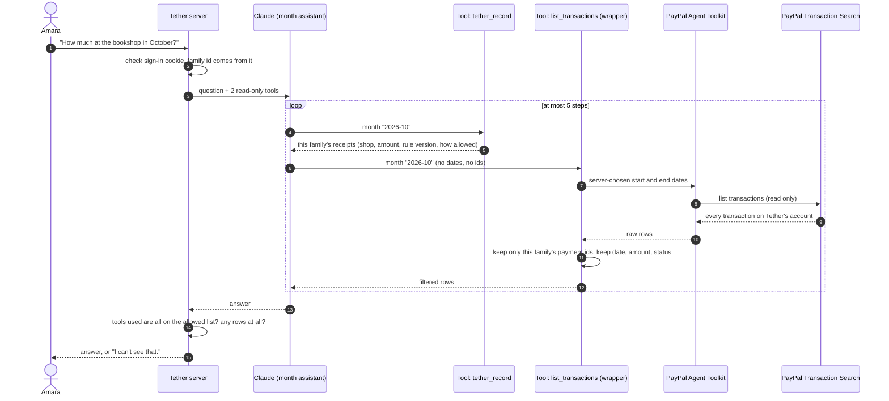

<p align="center">
  <picture>
    <source media="(prefers-color-scheme: dark)" srcset="public/brand/tether-inverse.svg">
    
  </picture>
</p>

# Tether

> A parent signs the rules. An AI agent proposes. Code decides. PayPal pays.

Tether lets a parent give a teenager real spending freedom online without handing over a card. The parent (Amara) signs a short set of weekly rules. Her teen (Zoe, 15) shops inside those rules. Every purchase is checked by plain code before a single PayPal call is made. Zoe earns more freedom by keeping her own savings promise four weeks in a row.

Built for the **PayPal AI Hackathon 2026** (Devpost). Submission deadline: **Thursday 12 November 2026, 12:00 PT**.

**Live app:** https://tether-five-beta.vercel.app (sandbox only, no real money moves)
**Demo video:** _link coming with the submission_

## Try it in five minutes

1. Open https://tether-five-beta.vercel.app and click **Open Zoe's view**. Her week shows one number: what she has left. Go to **Shop**, ask for something ("headphones under $30"). The AI agent searches only her allowed shops and labels every card *Fits your week*, *Needs Amara's OK* or *Over budget*. Open an over-budget card to see the amber refusal sentence and its two ways forward.
2. Back on the landing page, click **Open Amara's view**. **Home** shows what needs her: Zoe's over-budget ask. Open it: the budget consequence comes first. Tap **Approve**: Tether checks the cart against the signed rules again, mints a single-use permission slip and charges Amara's saved sandbox PayPal. In **Activity**, open **Proof** on that payment for its PayPal capture id, the permission slip and the rules version it ran under.
3. In **Zoe's rules**, search for a shop (try "Lego") and add it, or remove one. Each change asks once, then applies at once as a new rules version. Zoe can also search for a shop and ask Amara for it.
4. Ask the month assistant on **Home**: "What did Zoe buy this month?" It reads PayPal's transaction list and Tether's receipts, and can't move money.
5. On Amara's **Home**, press **Turn on notifications**, then ask for something as Zoe (in another tab or on another device): Amara's browser gets one push, and tapping it opens that request. The demo family is shared, so anyone who turns this on gets the demo's asks (at most 50 a day).
6. Open **Demo controls** at the bottom of Home and press **Advance to end of month**. Zoe kept her savings promise four weeks running, so the check-in in **Activity** moves her to Level 3 and offers the savings release. At Level 3 Zoe can search the whole market, read a facts-only fund page and propose an investment; Amara approves and Tether places a sandbox Alpaca order.

The demo is one shared family. **Reset demo** (in Demo controls on Amara's Home) puts it back, and it also resets itself when someone arrives more than 6 hours after the last reset. Dates are on a demo clock set to late December 2026 so a month fits in a few clicks; the screen says so.

---

## How it works

1. **Amara saves her PayPal once.** Tether stores a vault token (PayPal's way of letting a merchant charge you later without your password). Zoe never has a PayPal account; PayPal requires users to be 18+.
2. **Amara signs weekly rules.** Weekly amount, which shops, whether online purchases need her OK, how much Zoe promises to save. The signing screen reads like a contract. No AI is involved in it.
3. **Zoe asks the shopping agent** ("headphones under $30") or pastes a product link. The agent can only search the shops Amara allowed (via [Channel3](https://trychannel3.com)). It proposes 2–3 options. It cannot buy anything.
4. **Gate 1, code:** a deterministic rule engine checks the cart against the signed rules. Allowed, needs Amara's OK, or refused with one plain sentence saying which rule and what would change it.
5. **Gate 2, AI, can only tighten:** a model checks things code can't (is this item actually a book?). It can add friction; it can never remove it. *"A model may add friction. Only code may remove it."*
6. **PayPal charges Amara's saved wallet**, using a single-use permission slip (a signed token, valid 120 seconds, bound to that exact cart).
7. **Every week, what Zoe didn't spend becomes savings.** Four kept weeks in a row moves her up a level: more money, more shops, and at Level 3, investing.
8. **Investing (Level 3):** Zoe searches the whole market and proposes a fund. Tether shows facts only and recommends nothing. Amara approves each one; Tether places the order through Alpaca.
9. **Amara can ask about the month** ("How much at the bookshop in October?"). A read-only assistant answers from PayPal's transaction list and Tether's receipts. It cannot move money.

## How PayPal and AI are used

| What | How |
|---|---|
| **PayPal Vault** (save a wallet without a purchase) | Setup token → Amara approves → payment token. Charges use `payment_source.paypal.vault_id`. |
| **PayPal Orders v2** | Each approved cart is one order, charged to the vaulted wallet. Completes in one call, no separate capture. |
| **PayPal Webhooks** | Payment events reconcile Tether's ledger with PayPal. |
| **PayPal Agent Toolkit** (`@paypal/agent-toolkit`) | Read-only: only `list_transactions` is exposed, wrapped so the model sees only this family's rows (date, amount, status). |

Why charges use PayPal's REST API directly: the Agent Toolkit doesn't cover charging a vaulted wallet (or payouts), and Tether deliberately gives no model a tool that moves money. The toolkit is used where it fits: read-only questions about the month.
| **Claude** (`claude-haiku-5-5` via the Vercel AI SDK) | The propose-only shopping agent, the "is it a book?" check, plain-English refusal sentences, fund descriptions, and the month assistant. Every model output is validated, with a code fallback. |
| **Channel3** | Product search scoped to the parent's allowed shops; turns a pasted link into a real cart. |
| **Alpaca Broker API** (sandbox) | Investing: account, deposit, dollar-amount orders; market search and price history. |

## The AI: two agents, three checked calls

Tether uses AI where judgement helps and keeps it away from anything that decides or moves money. Only two pieces are agents (a model that loops, calling tools); the other three are single model calls whose output is checked by code. Every one has a plain code fallback, so the app works with the model switched off.

**Who can touch money.** Every AI piece sits on the left. Nothing on the left has a path to PayPal or Alpaca except through code that checks the signed rules and a human approval.





### 1. Shopping agent (agent) — `src/ai/agent.ts`

- **What it's for:** Zoe types "headphones under $30" or pastes a product link.
- **What it can see and do:** two tools — search the shops Amara allowed (Channel3), and look up a pasted product link. At most 6 tool calls, then it must answer.
- **What it returns:** 2–3 proposed carts, each with a reason of at most 80 characters. Each cart is run through the rule engine and labelled *fits*, *needs Amara's OK* or *over budget* before Zoe sees it.
- **What it cannot do:** buy anything, mint a permission slip, approve anything, change a rule, or touch PayPal. A test fails the build if this file imports anything that can. Product titles from shops are treated as untrusted data, never instructions. It can only propose items its own tools returned.



### 2. "Is it a book?" check (gate 2, single call) — `src/ai/classifier.ts`, `src/engine/gate2.ts`

- **What it's for:** rules code can't judge, like Level 2's "the bookshop, for books only" — Barnes & Noble also sells toys and games.
- **How it decides:** the model returns a probability; code turns it into an outcome using fixed thresholds.
- **What it cannot do:** loosen anything. Its outcome is combined with gate 1 so the stricter one wins. *"A model may add friction. Only code may remove it."*
- **When the model fails:** a 4-second timeout, an error or a nonsense answer all count as **refuse**, not allow.

### 3. Refusal sentences (single call) — `src/ai/explain.ts`

- **What it's for:** turning the rule engine's reasons into one kitchen-table sentence for Zoe, plus two ways forward (ask Amara, or wait).
- **Checks:** it may restate only the dollar amounts the engine gave it; it may never say a purchase is approved; it is capped at 240 characters. Anything else falls back to a fixed template.

### 4. Fund descriptions (single call) — `src/ai/fundWords.ts`

- **What it's for:** one plain sentence about what a fund is, on Zoe's investing screen.
- **Checks:** the model never sees prices and may write no numbers, no comparisons ("beat the market"), and no selling words ("great investment", "top pick"). The price lines are written by code. Anything off falls back to a template. Tether recommends nothing.

### 5. "Ask about the month" (agent) — `src/ai/monthAssistant.ts`

- **What it's for:** Amara asks things like "How much at the bookshop in October?"
- **What it can see:** two read-only tools — PayPal's transaction list (through the **PayPal Agent Toolkit**, configured with only `list_transactions`) and Tether's own receipts for the month. At most 5 steps.
- **Family-only:** every family's charges land in Tether's one PayPal account, so the PayPal tool is wrapped: the server picks the dates, keeps only rows whose payment id matches this family's receipts, and passes only date, amount and status. The model never sees other families, balances or free-text notes.
- **What it cannot do:** move money. No write tool exists in its toolset, and the toolkit can be imported only in this one file (enforced by lint). If the data isn't there it says "I can't see that."



## Tech stack

| Layer | Technology |
|---|---|
| App | Next.js 16 (App Router, Cache Components), React 19, TypeScript (strict) |
| Installable | Progressive web app (manifest, icons, offline page; money screens are never cached) |
| Database | Postgres via Drizzle ORM: Neon in production, PGlite (Postgres in-process) for local dev and tests |
| AI | Vercel AI SDK 7, `@ai-sdk/anthropic`, Claude Haiku |
| Payments | PayPal REST (Vault, Orders v2, Webhooks, Transaction Search), PayPal Agent Toolkit |
| Commerce data | Channel3 SDK |
| Investing | Alpaca Broker API + Market Data (sandbox) |
| Tests | Vitest (unit, integration on PGlite), Playwright (end-to-end) |
| Hosting | Vercel (production deploys from `main`), Neon Postgres |

## Status

Built, reviewed task by task, and running in production: the rule engine and permission slips, the AI gate, levels and the ledger, purchases, approvals (including Amara approving a one-off over budget, decision 013), weekly close and monthly level-ups, savings release, stopping the rules, investing, market search and fund facts, the month assistant, every parent and teen screen, the demo family with a month of real sandbox history, the installable app, and the deploy. 400+ unit and integration tests and a Playwright suite run in CI on every pull request; a separate live suite runs against the deployed site.

**Limits on the public demo** (it's one shared family whose link is public): Zoe's shopping agent 150 runs a day, searches and pasted links 400 a day, the month assistant 60 questions a day, and up to 300 shop look-ups an hour. Over a limit, the screen says so and no AI or Channel3 call is made. "Stop Zoe's rules" on the demo family stops the rules but keeps the shared saved PayPal, so the next person can try it; for a real family it also removes Tether's saved wallet at PayPal.

## Sandbox stand-ins (said plainly)

| In this build | In production |
|---|---|
| Every purchase pays **one Tether sandbox business account**; the receipt records which shop it was for. A saved PayPal wallet can only be charged by the business that saved it (verified: `BILLING_AGREEMENT_NOT_FOUND`). | Tether pays shops as a PayPal platform partner, or through shops' own agent checkouts. |
| Zoe's investments sit in an **ordinary Alpaca sandbox account**, labelled on screen as a stand-in. The sandbox refuses custodial accounts. One setting (`ALPACA_CUSTODIAL_ENABLED=true`) switches to the custodial request. | A custodial account Amara manages for Zoe. |
| Savings release: Amara sends the money herself and taps "I've sent it". | Same. Tether never holds money. |
| A demo clock moves time forward so a month fits in a video. | Real time. |
| Sign-in is a private link (signed cookie). | Passkeys. |
| One shared demo family that resets itself. | One family per household. |

## Quick start

### Prerequisites

- Node.js 22+ (the AI SDK requires it)
- pnpm 10 (`corepack enable`)
- Sandbox credentials: PayPal developer app, Anthropic API key, Channel3 API key, Alpaca Broker sandbox keys

### Install

```bash
git clone https://github.com/tmoody1973/tether.git
cd tether
pnpm install
cp .env.example .env.local
# fill in .env.local (see below)
```

For local development, point the database at an on-disk PGlite folder. It sets itself up on first use, no server needed:

```bash
# in .env.local
DATABASE_URL=pglite:./.pglite/dev
```

Generate a signing key:

```bash
node -e "console.log(require('crypto').randomBytes(32).toString('base64url'))"
```

### Run

```bash
pnpm dev          # http://localhost:3000
pnpm test         # unit + integration tests (PGlite)
pnpm e2e          # Playwright end-to-end tests
pnpm typecheck
pnpm lint
```

To create the demo family locally (it makes small **sandbox** PayPal charges and a sandbox Alpaca deposit; the script refuses to run against anything but the sandboxes):

```bash
pnpm tsx --env-file=.env.local scripts/seed.ts
```

To deploy your own copy: set the variables below in Vercel, run `DATABASE_URL=<neon url> pnpm tsx scripts/migrate.ts`, deploy, **seed before sharing the link**, then register a PayPal sandbox webhook at `https://<host>/api/paypal/webhook` and set `PAYPAL_WEBHOOK_ID`.

## Environment variables

| Variable | What it's for | Required |
|---|---|---|
| `DATABASE_URL` | Postgres URL (Neon), or `pglite:<folder>` locally | Yes |
| `APP_BASE_URL` | Public address, used for PayPal's return link and Zoe's link | Yes in production |
| `TETHER_SIGNING_KEY` | Signs permission slips and the parent's sign-in cookie (long random string) | Yes |
| `PAYPAL_CLIENT_ID` / `PAYPAL_CLIENT_SECRET` | PayPal sandbox app | Yes |
| `PAYPAL_BASE_URL` | `https://api-m.sandbox.paypal.com` (the app refuses anything else) | Yes |
| `PAYPAL_WEBHOOK_ID` | Verifies PayPal webhook signatures; the webhook refuses requests without it | Yes in production |
| `PAYPAL_DEMO_VAULT_ID` | Amara's saved sandbox PayPal, used by the demo seed | For the seed |
| `ANTHROPIC_API_KEY` | Claude, for the agent and the AI checks | Yes |
| `CHANNEL3_API_KEY` | Product search inside allowed shops | Yes |
| `ALPACA_BROKER_KEY` / `ALPACA_BROKER_SECRET` | Alpaca Broker sandbox (OAuth client credentials) | For investing |
| `ALPACA_BROKER_BASE_URL` | `https://broker-api.sandbox.alpaca.markets` | For investing |
| `ALPACA_DATA_BASE_URL` | `https://data.sandbox.alpaca.markets` | No (this default) |
| `ALPACA_FIRM_ACCOUNT_ID` | Funds deposits instantly by journal instead of a bank transfer | No |
| `ALPACA_CUSTODIAL_ENABLED` | `true` sends the custodial account request | No (default `false`) |
| `NEXT_PUBLIC_ONESIGNAL_APP_ID` | OneSignal app id (public). Shows Amara's "Turn on notifications" card; unset hides it | For push |
| `ONESIGNAL_REST_API_KEY` | OneSignal REST key, server only, never sent to a browser. Unset means push is off: asks still work, nothing is sent | For push (production only) |
| `DEMO_GUARDIAN_KEY` / `DEMO_TEEN_TOKEN` | Keys for the shared demo family (landing page buttons, Reset demo); leave both blank to hide the demo | For the public demo |

Never commit `.env.local`. It is git-ignored.

## Project structure

```
src/
├── engine/      Pure rule engine: evaluate, decide, cart hash, permission slips, levels (no I/O, enforced by lint)
├── ai/          Shopping agent, "is it a book?" check, refusal sentences, fund words, month assistant
├── flows/       Purchase, approvals, week and month, investing: transactions under a per-family lock
├── adapters/    PayPal, Channel3, Alpaca clients
├── db/          Drizzle schema, repositories, client (Neon or PGlite)
├── ledger/      Append-only journal and savings maths
├── auth/        Parent sign-in cookie
├── clock/       Real or demo clock
├── ui/          Design tokens and components
└── app/         Next.js routes: /g (parent), /t/[token] (teen), /api
tests/           Mirrors src/; e2e/ for Playwright
drizzle/         SQL migrations
docs/            Design spec, build plan, decision records, spike results
doc/             Product docs and screen mockups
```

## Design decisions

The reasoning behind the main choices is written up in plain English in [`docs/decisions/`](docs/decisions/): why money stays with the parent, why savings is the unspent allowance, why no charts for the teen, why level-ups run on Zoe's own commitment, why the PayPal toolkit is read-only, and why money that reaches the broker never shows back in savings.

The full design is in [`docs/superpowers/specs/2026-11-05-tether-hackathon-design.md`](docs/superpowers/specs/2026-11-05-tether-hackathon-design.md).

## Team

Tarik Moody, built with Claude Code.

## License

[MIT](LICENSE)
